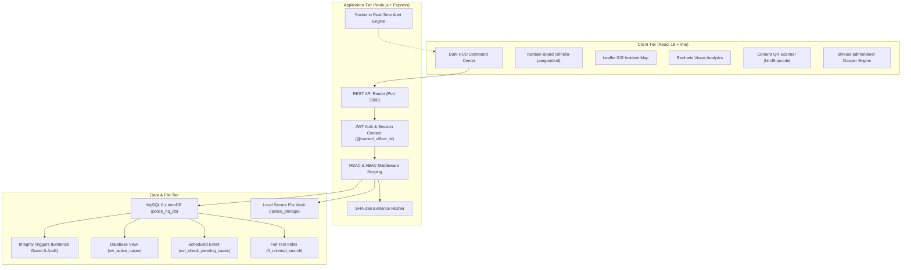

# Maharashtra Police Headquarters Data Management System (PHDMS)

[](https://www.mysql.com/)
[](https://nodejs.org/)
[](https://reactjs.org/)
[](file:///c:/Users/vaish/.gemini/antigravity/scratch/police-hq-management/server/tests/e2e.test.js)

---

## 1. Project Overview

The **Police Headquarters Data Management System (PHDMS)** is an enterprise-grade, local-first 3-tier academic DBMS application modeled on the operational hierarchy and procedural law of the **Maharashtra State Police** (Mumbai & Pune Commissionerates).

The system digitizes police precinct operations, replacing physical Station General Diaries, Malkhana inventory books, and suspect dossiers with an ACID-compliant, cryptographically verifiable relational database.

### Key Capabilities
- **Relational Integrity & Normalization:** 15 relational tables fully normalized to **3NF / BCNF**, complete with MySQL 8 triggers, views, daily maintenance events, and full-text inverted search indexes.
- **Role & Jurisdictional Scoping (RBAC & ABAC):** Granular access policies ensuring precinct officers are isolated to their home police stations, while Headquarters Command has statewide visibility. Protected witness identities are masked automatically.
- **Operational Case Kanban:** Drag-and-drop 5-stage case lifecycle management (`Filed` $\to$ `Under Investigation` $\to$ `Warrant Issued` $\to$ `In Court` $\to$ `Closed / Cold`).
- **Malkhana Vault & Chain of Custody:** Physical and digital evidence intake with streaming **SHA-256 cryptographic hashing**, device camera **QR code scanning**, and immutable chain-of-custody transfer tracking.
- **GIS Crime Incident Map:** Dark CartoDB incident map rendering real-time coordinate clusters, severity glow markers, and precinct jurisdictional radii (Azad Maidan, Bandra, Shivaji Nagar).
- **Executive Analytics & BOLO Broadcasts:** Recharts visualizations (12-month crime trends, statutory category distribution, detective clearance rankings) with WebSocket-driven real-time BOLO urgent alerts.
- **Forensic PDF Dossier Export:** Client-side generation of official Maharashtra Police Case Files via `@react-pdf/renderer`.

---

## 2. System Architecture



---

## 3. Technology Stack

| Layer | Technology | Purpose |
|---|---|---|
| **Database** | MySQL 8.x (InnoDB Engine) | ACID transactions, foreign keys, triggers, views, events, full-text index |
| **Driver / Pool** | `mysql2/promise` | Connection pooling with parameter-bound prepared statements |
| **Backend Runtime** | Node.js (v18+) & Express | RESTful API, authentication, file streaming, socket orchestration |
| **Real-Time Engine** | Socket.io | Bi-directional WebSocket rooms for instant BOLO broadcasts |
| **Frontend Framework** | React 18 (Vite Bundler) | Single Page Application with optimized component tree |
| **UI Styling** | TailwindCSS + Lucide Icons | Police Tactical Dark HUD theme |
| **Interactive Kanban** | `@hello-pangea/dnd` | Smooth drag-and-drop case progression with optimistic state updates |
| **GIS Mapping** | Leaflet & `react-leaflet` | Geospatial crime scene mapping with dark CartoDB tile layers |
| **Visual Charts** | Recharts | 12-month trend charts, crime type donuts, officer closure rankings |
| **QR Code Scanner** | `html5-qrcode` & `qrcode` | Real-time camera barcode scanner and QR code badge generation |
| **Dossier Generator** | `@react-pdf/renderer` | Client-side statutory Maharashtra Police dossier PDF export |

---

## 4. Quickstart & Installation Guide

### Prerequisites
- [Node.js](https://nodejs.org/) v18.0.0 or higher
- [MySQL Server](https://dev.mysql.com/downloads/mysql/) 8.0 or higher running on `localhost:3306`

### 1. Clone & Configure Environment

```bash
# Clone the repository
git clone https://github.com/your-org/police-hq-management.git
cd police-hq-management
```

Create server environment configuration:
```bash
# In server/
copy server\.env.example server\.env
```
Default `.env` configuration:
```env
PORT=5000
NODE_ENV=development
DB_HOST=localhost
DB_USER=root
DB_PASSWORD=your_mysql_password
DB_NAME=police_hq_db
DB_PORT=3306
JWT_SECRET=super_secret_police_hq_jwt_key_2026_secure
JWT_EXPIRES_IN=8h
STORAGE_ROOT=../police_storage
CORS_ORIGIN=http://localhost:5173
```

### 2. Initialize Database & Seed Authentic Maharashtra Dataset

Run the automated database initializer. This script creates the database, provisions all 15 tables, registers triggers, views, and scheduled events, and seeds realistic officers, FIRs, evidence, and criminal profiles:

```bash
node database/init.js
```

### 3. Install Dependencies & Launch Application

#### Launch Backend Server (Terminal 1)
```bash
cd server
npm install
npm run dev
# Server will start on http://localhost:5000
```

#### Launch Frontend Client (Terminal 2)
```bash
cd client
npm install
npm run dev
# Client will start on http://localhost:5173
```

---

## 5. Authentic Demo Credentials & Role Access

The seed dataset contains authentic Maharashtra Police personnel across different commissionerates and operational roles:

| Badge Number | Officer Name | Rank | Assigned Station | Role Clearance | Capabilities & Scoping | Password |
|---|---|---|---|---|---|---|
| **MH-HQ-001** | Asha Kulkarni | Director General of Police (DGP) | Mumbai HQ & Azad Maidan (ID: 1) | `System-Admin` | **Statewide Access:** Unrestricted visibility across all precincts; can edit, transfer, reassign, view unmasked protected witnesses, and broadcast statewide alerts. | `Admin@123` |
| **MH-HQ-002** | Sachin Sawant | Senior Police Inspector (Sr. PI) | Azad Maidan PS (ID: 1) | `Officer` | **Precinct Scoped:** Restricted strictly to Azad Maidan records; cross-station access blocked; protected witness identities masked. | `Officer@123` |
| **MH-HQ-003** | Ganesh More | Assistant Sub-Inspector (ASI) | Azad Maidan PS (ID: 1) | `Evidence-Manager` | **Malkhana Scoped:** Authorized for evidence intake, barcode printing, and custody transfers within Azad Maidan vault. | `Evidence@123` |
| **MH-HQ-004** | Priya Kadam | Assistant Commissioner of Police (ACP) | Bandra Police Station (ID: 2) | `Officer` | **Zone IX Scoped:** Restricted to Bandra Police Station cases and FIRs. | `Officer@123` |
| **MH-HQ-005** | Vikram Rane | Deputy Commissioner of Police (DCP) | Shivaji Nagar Pune (ID: 3) | `Head-Officer` | **Pune Zone Scoped:** Supervises Pune precinct operations, full regional clearance, protected witness access. | `Officer@123` |

---

## 6. Comprehensive API Endpoint Catalog

### Authentication
- `POST /api/auth/login` — Authenticate badge number and password; returns signed JWT.
- `GET /api/auth/profile` — Retrieve active authenticated officer profile and permissions.

### Stations & Officers
- `GET /api/stations` — List all registered police stations (ABAC scoped).
- `GET /api/stations/:id` — Retrieve detailed station metadata and jurisdiction radius.
- `GET /api/officers` — List active officers within jurisdiction.
- `POST /api/officers` — Register new police officer (`System-Admin` only).

### FIRs (First Information Reports)
- `GET /api/firs` — List FIRs with crime classification and GPS incident coordinates.
- `POST /api/firs` — Atomic FIR registration; automatically initializes linked Case in stage `'Filed'`.
- `GET /api/firs/:id` — Retrieve full FIR dossier.

### Cases (Kanban Investigation Engine)
- `GET /api/cases` — Retrieve cases with dynamic `days_active` duration from `vw_active_cases`.
- `GET /api/cases/:id` — Retrieve comprehensive case dossier with FIR, evidence, warrants, and hearings.
- `PATCH /api/cases/:id` — Update case stage, assigned lead officer, or priority (triggers `trg_audit_case_update`).

### Criminal Registry & Full-Text Search
- `GET /api/criminals` — List criminal dossiers.
- `GET /api/criminals/search?q=...` — High-performance full-text boolean query against `ft_criminal_search`.
- `POST /api/criminals` — Register suspect profile with alias, DOB, and physical traits.

### Evidence & Malkhana Custody
- `GET /api/evidence` — List seized weapons, narcotics, digital media, and cash exhibits.
- `POST /api/evidence` — Malkhana intake with multipart file upload, automatic SHA-256 digest computation, and QR code payload generation.
- `POST /api/evidence/:id/custody` — Transfer chain of custody to another officer with mandatory transfer reason.
- `GET /api/evidence/:id/verify` — Real-time cryptographic SHA-256 verification of disk file against ledger hash.

### Legal & Auxiliary
- `GET /api/warrants` — List arrest and search warrants with expiration alerts.
- `POST /api/warrants` — Issue judicial warrant for suspect.
- `GET /api/court-dates` — Court hearing calendar.
- `POST /api/court-dates` — Schedule hearing; advances case stage to `'In Court'`.
- `GET /api/witnesses` — List victims and witnesses (protected informants masked for non-admin roles).
- `GET /api/arrests` — Suspect lockup and bail ledger.
- `GET /api/audit-logs` — Immutable audit trail of case modifications and administrative actions.

### Analytics & Alerts
- `GET /api/analytics/kpis` — Total FIRs, active cases, evidence items, and open warrants.
- `GET /api/analytics/trends` — 12-month grouped incident vs. closure trend data.
- `GET /api/analytics/distribution` — Crime category distribution percentages.
- `GET /api/analytics/officer-performance` — Officer closure rates and active workload rankings.
- `GET /api/alerts` — Real-time alerts and BOLO announcements.
- `POST /api/alerts/bolo` — Broadcast urgent All-Points Bulletin via WebSocket.
- `PATCH /api/alerts/:id/read` — Mark alert as acknowledged.

---

## 7. Verification & Automated Test Suite

The system includes a 6-suite automated test framework testing end-to-end integration, cryptographic hashing, RBAC/ABAC boundaries, and business rules:

```bash
cd server
npm test
```

### Test Suite Results: 43/43 Passing (100% Pass Rate)

```
▶ ANALYTICS & BOLO ALERTS SUITE: KPIs, Trends, BOLO Broadcast & Socket Rooms
  ✔ 1. Alert severity enumerations are strictly defined
  ✔ 2. BOLO Alert validation and payload construction with audit structure
  ✔ 3. Automated 90-day cold case detection rule
  ✔ 4. Officer case-closure rate calculation handles zero-case edge cases safely
  ✔ 5. Socket.io JWT handshake and multi-room subscription logic
✔ ANALYTICS & BOLO ALERTS SUITE (5 tests passed)

▶ AUTH & SECURITY SUITE: Token, RBAC & ABAC Verification
  ✔ 1. generateToken produces valid signed JWT with correct payload
  ✔ 2. Token verification rejects expired or forged token
  ✔ 3. RBAC authorizeRoles middleware allows permitted roles
  ✔ 4. RBAC authorizeRoles middleware denies unauthorized roles with 403
  ✔ 5. ABAC enforceStationJurisdiction allows System-Admin across all precincts
  ✔ 6. ABAC enforceStationJurisdiction permits Officer within matching station
  ✔ 7. ABAC enforceStationJurisdiction rejects Officer attempting cross-station action
  ✔ 8. authValidator rejects missing badge number and normalizes casing
✔ AUTH & SECURITY SUITE (8 tests passed)

▶ MASTER END-TO-END SYSTEM INTEGRATION SUITE (PHDMS v2.0)
  ✔ 1. Security: Multi-Role Token Issuance & Signature Verification
  ✔ 2. ABAC: Precinct Jurisdictional Boundary Enforcement Rules
  ✔ 3. Operational Lifecycle: Atomic FIR-to-Case Conversion & Kanban Progression
  ✔ 4. Evidence Management: SHA-256 Hashing, Genesis Custody & Deletion Guard
  ✔ 5. Judicial Integration: Hearing Scheduling Advances Case to "In Court"
  ✔ 6. Security Protocol: Role-Based Protected Witness Redaction
  ✔ 7. Real-Time Alerts: BOLO Urgency Validation & Read Receipt Tracking
✔ MASTER END-TO-END SYSTEM INTEGRATION SUITE (7 tests passed)

▶ EVIDENCE & INTEGRITY SUITE: SHA-256, Custody Ledger & QR Verification
  ✔ 1. Evidence types include required physical and digital classifications
  ✔ 2. Cryptographic SHA-256 produces exact 64-character hexadecimal digest
  ✔ 3. Integrity verification algorithm detects file tampering
  ✔ 4. Closed case evidence deletion protection logic
  ✔ 5. Custody transfer authorization logic restricts unauthorized officers
  ✔ 6. QR code payload generation and parser handles both JSON and raw numbers
✔ EVIDENCE & INTEGRITY SUITE (6 tests passed)

▶ LEGAL & AUXILIARY SUITE: Warrants, Hearings, Custody & Audit Integrity
  ✔ 1. Legal status and decision enumerations are strictly defined
  ✔ 2. Warrant execution logic sets execution_date when status changes to Executed
  ✔ 3. Bail status and release timestamp logic enforces proper state transitions
  ✔ 4. Protected witness redaction accurately secures confidential informants across roles
  ✔ 5. Audit logs API enforces append-only immutability
✔ LEGAL & AUXILIARY SUITE (5 tests passed)

▶ CORE OPERATIONS SUITE: Business Logic, ABAC & Data Integrity
  ✔ 1. Case statuses strictly match the 5-stage Kanban lifecycle plus Cold
  ✔ 2. Criminal involvement types are strictly constrained
  ✔ 3. Coordinate validation correctly filters invalid ranges
  ✔ 4. Witness redaction protects confidential panchnama witnesses for standard officers
  ✔ 5. Full-text search term formatting expands tokens with wildcard for BOOLEAN MODE
  ✔ 6. Dynamic days_active computation handles both active and closed cases
✔ CORE OPERATIONS SUITE (6 tests passed)

ℹ tests 43 | pass 43 | fail 0 | cancelled 0 | skipped 0
```

### Production Client Build
```bash
cd client
npm run build
# ✓ 2790 modules transformed. built in 6.48s (0 errors)
```

---

## 8. Academic Documentation & Viva Voce Guide

- **[Master Data Dictionary](file:///c:/Users/vaish/.gemini/antigravity/scratch/police-hq-management/docs/data-dictionary.md):** Complete column specifications, datatypes, default values, nullability, and foreign key constraints for all 15 tables.
- **[Academic Viva Voce Defense Guide](file:///c:/Users/vaish/.gemini/antigravity/scratch/police-hq-management/docs/viva-presentation-guide.md):** In-depth mathematical normalization proofs (1NF $\to$ BCNF), InnoDB storage engine mechanics, transaction isolation, trigger error signaling, and **25 DBMS professor viva questions and model answers**.
- **[Requirements Traceability Matrix](file:///c:/Users/vaish/.gemini/antigravity/scratch/police-hq-management/docs/requirements-matrix.md):** Functional requirement mapping across all 12 project phases.

---

## 9. License & Academic Attribution
Developed as an academic software engineering and advanced DBMS project representing the Maharashtra State Police Department command architecture.
