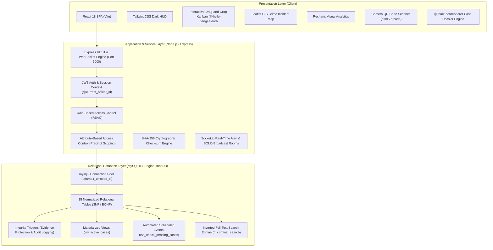
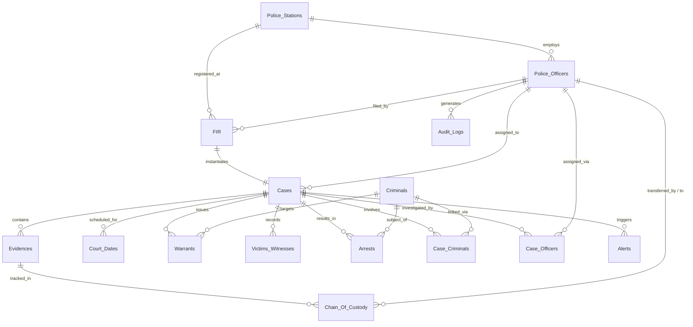

# Police Headquarters Data Management System (PHDMS)
## Academic Defense Dossier & DBMS Viva Voce Guide

---

## 1. Executive System Architecture & Project Scope

The **Police Headquarters Data Management System (PHDMS)** is an enterprise-grade, local-first academic Database Management System designed to simulate the digital command infrastructure of the **Maharashtra State Police Department** (Mumbai & Pune Commissionerates).

The system replaces manual physical paperwork (Station General Diaries, Malkhana registers, and physical dossier files) with a cryptographically verifiable, multi-precinct relational database.

### 1.1 Technical Stack & Layering



---

## 2. Relational Schema & Entity-Relationship Modeling

The database comprises **15 relational tables** modeling the complete life cycle of criminal investigations, custody transfers, judicial proceedings, and officer accountability.

### 2.1 Entity-Relationship Overview



---

## 3. Normalization Proofs (1NF to BCNF)

A major criterion of database rigor is eliminating update, insertion, and deletion anomalies through formal normalization. All 15 relations in PHDMS satisfy **Boyce-Codd Normal Form (BCNF)** and **Third Normal Form (3NF)**.

### 3.1 Normalization Criteria Definitions

1. **First Normal Form (1NF):**
   - Each table has a defined Primary Key.
   - All attribute values are atomic (indivisible scalars; no multivalued attributes or repeated groups like comma-separated telephone numbers or nested arrays).
2. **Second Normal Form (2NF):**
   - The relation is in 1NF.
   - No non-prime attribute is partially dependent on any candidate key (full functional dependency: for any candidate key $K$ and non-prime attribute $A$, $K \to A$ holds, and no proper subset $K' \subset K$ determines $A$).
3. **Third Normal Form (3NF):**
   - The relation is in 2NF.
   - No non-prime attribute is transitively dependent on any candidate key (for every functional dependency $X \to Y$, either $X$ is a superkey, or $Y$ is a prime attribute).
4. **Boyce-Codd Normal Form (BCNF):**
   - A stricter version of 3NF. For every non-trivial functional dependency $X \to Y$, the determinant $X$ must be a **superkey**.

---

### 3.2 Formal Table-by-Table Normalization Proofs

#### Table 1: `Police_Stations`
- **Schema:** `Police_Stations(id, name, location, contact_details, is_deleted, created_at, updated_at)`
- **Candidate Keys:** $\{id\}$, $\{name\}$
- **Functional Dependencies (FDs):**
  - $id \to \{name, location, contact_details, is_deleted, created_at, updated_at\}$
  - $name \to \{id, location, contact_details, is_deleted, created_at, updated_at\}$
- **Proof:**
  - **1NF:** All fields (`id`, `name`, `location`, `contact_details`) contain atomic strings/integers. No nested lists.
  - **2NF:** The primary key $\{id\}$ is a single attribute. Partial dependency is impossible because no composite candidate key exists.
  - **3NF & BCNF:** In every non-trivial FD ($id \to \dots$ and $name \to \dots$), the left-hand side is a superkey. No transitive dependencies exist.

#### Table 2: `Police_Officers`
- **Schema:** `Police_Officers(id, badge_number, first_name, last_name, rank_title, role, station_id, password_hash, email, phone, is_deleted, created_at, updated_at)`
- **Candidate Keys:** $\{id\}$, $\{badge\_number\}$, $\{email\}$
- **Foreign Key:** $station\_id \to Police\_Stations(id)$
- **Functional Dependencies:**
  - $id \to \{badge\_number, first\_name, last\_name, rank\_title, role, station\_id, password\_hash, email, phone, \dots\}$
  - $badge\_number \to \{id, first\_name, last\_name, rank\_title, role, station\_id, password\_hash, email, phone, \dots\}$
  - $email \to \{id, badge\_number, \dots\}$
- **Proof:**
  - Station metadata (e.g. station name, location) is extracted to `Police_Stations` and referenced via $station\_id$. Storing station address here would introduce $station\_id \to station\_address$, a transitive dependency violating 3NF.
  - Since station details are normalized into a foreign table, all non-key attributes depend solely on candidate keys $\{id\}$, $\{badge\_number\}$, and $\{email\}$. Hence, **BCNF is satisfied**.

#### Table 3: `Criminals`
- **Schema:** `Criminals(id, first_name, last_name, alias, dob, gender, physical_description, mugshot_path, is_deleted, created_at, updated_at)`
- **Candidate Key:** $\{id\}$
- **Functional Dependencies:**
  - $id \to \{first\_name, last\_name, alias, dob, gender, physical\_description, mugshot\_path, is\_deleted, \dots\}$
- **Proof:**
  - Multiple offenses committed by a criminal are **not** stored as arrays or repeating columns within this table (which would violate 1NF). Instead, case affiliations are decoupled into the junction relation `Case_Criminals`.
  - All attributes represent immutable or direct biographical characteristics determined exclusively by $id$. Hence, **BCNF is satisfied**.

#### Table 4: `FIR` (First Information Reports)
- **Schema:** `FIR(id, fir_number, station_id, filed_by_officer_id, date_filed, incident_date, crime_type, description, status, latitude, longitude, is_deleted, created_at, updated_at)`
- **Candidate Keys:** $\{id\}$, $\{fir\_number\}$
- **Foreign Keys:** $station\_id \to Police\_Stations(id)$, $filed\_by\_officer\_id \to Police\_Officers(id)$
- **Functional Dependencies:**
  - $id \to \{fir\_number, station\_id, filed\_by\_officer\_id, date\_filed, incident\_date, crime\_type, description, status, latitude, longitude, \dots\}$
  - $fir\_number \to \{id, station\_id, \dots\}$
- **Proof:**
  - Officer particulars (rank, name) and station location are strictly externalized via foreign keys.
  - Geographic coordinates (`latitude`, `longitude`) define the physical location of the incident, not the station.
  - Every determinant is a candidate key. Hence, **BCNF is satisfied**.

#### Table 5: `Cases`
- **Schema:** `Cases(id, case_number, fir_id, assigned_officer_id, case_status, priority, open_date, close_date, is_deleted, created_at, updated_at)`
- **Candidate Keys:** $\{id\}$, $\{case\_number\}$, $\{fir\_id\}$
- **Foreign Keys:** $fir\_id \to FIR(id)$, $assigned\_officer\_id \to Police\_Officers(id)$
- **Functional Dependencies:**
  - $id \to \{case\_number, fir\_id, assigned\_officer\_id, case\_status, priority, open_date, close_date, \dots\}$
  - $case\_number \to \{id, fir\_id, \dots\}$
  - $fir\_id \to \{id, case\_number, \dots\}$ (1-to-1 relationship between FIR and primary active Case)
- **Proof:**
  - Incident narrative and station ID are omitted from `Cases` to avoid redundancy with `FIR`. Access to station ID is traversed via $Cases \bowtie FIR$.
  - Calculated duration (`days_active`) is not stored as a static column (which would cause update anomalies as real-world time progresses), but computed dynamically in the database view `vw_active_cases`.
  - Every determinant is a candidate key. Hence, **BCNF is satisfied**.

#### Table 6: `Evidences`
- **Schema:** `Evidences(id, case_id, description, evidence_type, storage_location, collected_by_officer_id, collected_date, secure_hash, file_path, is_deleted, created_at, updated_at)`
- **Candidate Key:** $\{id\}$
- **Foreign Keys:** $case\_id \to Cases(id)$, $collected\_by\_officer\_id \to Police\_Officers(id)$
- **Functional Dependencies:**
  - $id \to \{case\_id, description, evidence\_type, storage\_location, collected\_by\_officer\_id, collected\_date, secure\_hash, file\_path, \dots\}$
- **Proof:**
  - Historical custody handoffs are removed from this relation into `Chain_Of_Custody`. Storing current or historical possessors in `Evidences` would create repeated records or update anomalies.
  - The cryptographic checksum (`secure_hash`) is determined by the physical file bytes at intake. Hence, **BCNF is satisfied**.

#### Table 7: `Chain_Of_Custody`
- **Schema:** `Chain_Of_Custody(id, evidence_id, transferred_from_officer_id, transferred_to_officer_id, transfer_date, reason, created_at)`
- **Candidate Key:** $\{id\}$
- **Foreign Keys:** $evidence\_id \to Evidences(id)$, $transferred\_from\_officer\_id \to Police\_Officers(id)$, $transferred\_to\_officer\_id \to Police\_Officers(id)$
- **Functional Dependencies:**
  - $id \to \{evidence\_id, transferred\_from\_officer\_id, transferred\_to\_officer\_id, transfer\_date, reason, created\_at\}$
- **Proof:**
  - Models a strict append-only ledger of physical possession. No update or delete operations are permitted.
  - Since $id$ is the solitary determinant for all attributes, no partial or transitive dependencies exist. Hence, **BCNF is satisfied**.

#### Table 8: `Court_Dates`
- **Schema:** `Court_Dates(id, case_id, court_name, hearing_date, judge_name, hearing_outcome, next_hearing_date, is_deleted, created_at, updated_at)`
- **Candidate Key:** $\{id\}$
- **Foreign Key:** $case\_id \to Cases(id)$
- **Functional Dependencies:**
  - $id \to \{case\_id, court\_name, hearing\_date, judge\_name, hearing\_outcome, next\_hearing\_date, \dots\}$
- **Proof:**
  - A case may have $N$ sequential hearings. Decoupling hearing sessions from `Cases` ensures 1NF compliance (no repeating groups).
  - All attributes describe a specific hearing instance. Hence, **BCNF is satisfied**.

#### Table 9: `Warrants`
- **Schema:** `Warrants(id, case_id, criminal_id, warrant_type, issue_date, expiration_date, status, execution_date, judge_name, is_deleted, created_at, updated_at)`
- **Candidate Key:** $\{id\}$
- **Foreign Keys:** $case\_id \to Cases(id)$, $criminal\_id \to Criminals(id)$
- **Functional Dependencies:**
  - $id \to \{case\_id, criminal\_id, warrant\_type, issue\_date, expiration\_date, status, execution\_date, judge\_name, \dots\}$
- **Proof:**
  - A single case may spawn arrest warrants for multiple suspects, or a single suspect may have multiple warrants over time.
  - Separation into an independent relation prevents multi-valued dependencies in `Cases` or `Criminals`. Hence, **BCNF is satisfied**.

#### Table 10: `Victims_Witnesses`
- **Schema:** `Victims_Witnesses(id, case_id, full_name, contact_details, statement, is_protected, person_type, is_deleted, created_at, updated_at)`
- **Candidate Key:** $\{id\}$
- **Foreign Key:** $case\_id \to Cases(id)$
- **Functional Dependencies:**
  - $id \to \{case\_id, full\_name, contact\_details, statement, is\_protected, person\_type, \dots\}$
- **Proof:**
  - Preserves anonymity and redaction rules for protected informants (`is_protected = TRUE`).
  - Decoupled from `FIR` and `Cases` to allow $M$ witnesses per case without column replication. Hence, **BCNF is satisfied**.

#### Table 11: `Arrests`
- **Schema:** `Arrests(id, case_id, criminal_id, arresting_officer_id, arrest_date, arrest_location, bail_status, release_date, is_deleted, created_at, updated_at)`
- **Candidate Key:** $\{id\}$
- **Foreign Keys:** $case\_id \to Cases(id)$, $criminal\_id \to Criminals(id)$, $arresting\_officer\_id \to Police\_Officers(id)$
- **Functional Dependencies:**
  - $id \to \{case\_id, criminal\_id, arresting\_officer\_id, arrest\_date, arrest\_location, bail\_status, release\_date, \dots\}$
- **Proof:**
  - Captures the exact physical event and judicial lockup status of apprehension.
  - Fully normalized with zero transitive dependencies. Hence, **BCNF is satisfied**.

#### Table 12: `Case_Criminals` (M:N Decomposition)
- **Schema:** `Case_Criminals(case_id, criminal_id, involvement_type, is_deleted, created_at)`
- **Composite Primary Key:** $\{case\_id, criminal\_id\}$
- **Foreign Keys:** $case\_id \to Cases(id)$, $criminal\_id \to Criminals(id)$
- **Functional Dependencies:**
  - $\{case\_id, criminal\_id\} \to \{involvement\_type, is\_deleted, created\_at\}$
- **Proof:**
  - Resolves the Many-to-Many ($M:N$) cardinality between `Cases` and `Criminals` (one case involves multiple suspects/masterminds; one criminal commits multiple cases).
  - The non-prime attribute `involvement_type` (e.g. `'Mastermind'`, `'Suspect'`, `'Accomplice'`) is functionally dependent on the entire composite key $\{case\_id, criminal\_id\}$. It cannot be determined by $case\_id$ alone or $criminal\_id$ alone.
  - No partial key dependency exists. Hence, **2NF and BCNF are fully satisfied**.

#### Table 13: `Case_Officers` (M:N Decomposition)
- **Schema:** `Case_Officers(case_id, officer_id, role, assigned_date, is_deleted, created_at)`
- **Composite Primary Key:** $\{case\_id, officer\_id\}$
- **Foreign Keys:** $case\_id \to Cases(id)$, $officer\_id \to Police\_Officers(id)$
- **Functional Dependencies:**
  - $\{case\_id, officer\_id\} \to \{role, assigned\_date, is\_deleted, created\_at\}$
- **Proof:**
  - Resolves the Many-to-Many cardinality between `Cases` and investigating `Police_Officers`.
  - Non-prime attributes `role` (e.g. `'Lead Investigator'`, `'Forensics Officer'`) depend on the full composite key.
  - Hence, **BCNF is satisfied**.

#### Table 14: `Audit_Logs`
- **Schema:** `Audit_Logs(id, officer_id, action, target_table, record_id, details, timestamp)`
- **Candidate Key:** $\{id\}$
- **Foreign Key:** $officer\_id \to Police\_Officers(id)$
- **Functional Dependencies:**
  - $id \to \{officer\_id, action, target\_table, record\_id, details, timestamp\}$
- **Proof:**
  - High-performance, append-only security ledger.
  - Primary key $id$ is the sole determinant. Hence, **BCNF is satisfied**.

#### Table 15: `Alerts`
- **Schema:** `Alerts(id, case_id, alert_message, severity, is_read, created_at)`
- **Candidate Key:** $\{id\}$
- **Foreign Key:** $case\_id \to Cases(id)$ (nullable for broadcast BOLOs)
- **Functional Dependencies:**
  - $id \to \{case\_id, alert\_message, severity, is\_read, created\_at\}$
- **Proof:**
  - Single primary key determinant. Hence, **BCNF is satisfied**.

---

## 4. Advanced MySQL 8 Features: Mechanics & Implementation

### 4.1 Integrity Triggers

MySQL Triggers enforce domain integrity constraints directly within the database engine, guaranteeing enforcement regardless of whether writes originate from the web application, a migration script, or a direct DBA terminal.

#### 1. Evidence Deletion Guard: `trg_prevent_evidence_delete`
- **Event:** `BEFORE DELETE ON Evidences FOR EACH ROW`
- **Business Rule:** Under the Indian Evidence Act & Maharashtra Police Regulations, evidence linked to a finalized judicial proceeding or closed investigation can never be purged or destroyed arbitrarily.
- **Implementation:**
```sql
DELIMITER $$
CREATE TRIGGER trg_prevent_evidence_delete
BEFORE DELETE ON Evidences
FOR EACH ROW
BEGIN
    DECLARE v_status VARCHAR(50);
    SELECT case_status INTO v_status FROM Cases WHERE id = OLD.case_id;
    IF v_status = 'Closed' THEN
        SIGNAL SQLSTATE '45000'
        SET MESSAGE_TEXT = 'Integrity Violation: Cannot delete evidence associated with a closed case';
    END IF;
END$$
DELIMITER ;
```
- **Technical Detail:** Uses `SIGNAL SQLSTATE '45000'` (user-defined unhandled exception class) to abort the transaction before disk mutation occurs.

#### 2. Case State Transition Auditor: `trg_audit_case_update`
- **Event:** `AFTER UPDATE ON Cases FOR EACH ROW`
- **Business Rule:** Every change to a case's lifecycle stage, priority, or investigating officer must be automatically journaled with the identity of the modifying actor.
- **Actor Propagation Strategy:** Express services execute `SET @current_officer_id = ?;` on the active connection prior to issuing `UPDATE` statements. The trigger retrieves `COALESCE(@current_officer_id, NEW.assigned_officer_id)`.
- **Implementation:**
```sql
DELIMITER $$
CREATE TRIGGER trg_audit_case_update
AFTER UPDATE ON Cases
FOR EACH ROW
BEGIN
    DECLARE v_actor_id INT;
    SET v_actor_id = COALESCE(@current_officer_id, NEW.assigned_officer_id);
    
    IF OLD.case_status <> NEW.case_status 
       OR OLD.assigned_officer_id <> NEW.assigned_officer_id 
       OR OLD.priority <> NEW.priority THEN
        INSERT INTO Audit_Logs (officer_id, action, target_table, record_id, details)
        VALUES (
            v_actor_id,
            'CASE_UPDATE',
            'Cases',
            NEW.id,
            CONCAT(
                'Status: ', OLD.case_status, ' -> ', NEW.case_status,
                '; Officer: ', COALESCE(CAST(OLD.assigned_officer_id AS CHAR), 'Unassigned'), 
                ' -> ', COALESCE(CAST(NEW.assigned_officer_id AS CHAR), 'Unassigned'),
                '; Priority: ', OLD.priority, ' -> ', NEW.priority
            )
        );
    END IF;
END$$
DELIMITER ;
```

---

### 4.2 Database Views: `vw_active_cases`

```sql
CREATE OR REPLACE VIEW vw_active_cases AS
SELECT 
    c.id,
    c.case_number,
    c.fir_id,
    f.fir_number,
    f.crime_type,
    f.station_id,
    s.name AS station_name,
    c.assigned_officer_id,
    CONCAT(o.first_name, ' ', o.last_name) AS assigned_officer_name,
    o.badge_number AS assigned_officer_badge,
    c.case_status,
    c.priority,
    c.open_date,
    c.close_date,
    DATEDIFF(COALESCE(c.close_date, CURDATE()), c.open_date) AS days_active,
    c.created_at,
    c.updated_at
FROM Cases c
JOIN FIR f ON c.fir_id = f.id
JOIN Police_Stations s ON f.station_id = s.id
LEFT JOIN Police_Officers o ON c.assigned_officer_id = o.id
WHERE c.is_deleted = FALSE;
```

#### Why a View Instead of a Generated Column?
MySQL generated columns (`GENERATED ALWAYS AS ... STORED / VIRTUAL`) **forbid non-deterministic expressions** such as `CURDATE()`, `NOW()`, or subqueries because their value changes with each passing day without a row update. A database view solves this cleanly by dynamically evaluating `DATEDIFF(COALESCE(c.close_date, CURDATE()), c.open_date)` at query execution time with zero denormalization penalty.

---

### 4.3 Scheduled Maintenance Events: `evt_check_pending_cases`

```sql
DELIMITER $$
CREATE EVENT IF NOT EXISTS evt_check_pending_cases
ON SCHEDULE EVERY 1 DAY
STARTS (CURRENT_TIMESTAMP + INTERVAL 1 HOUR)
DO
BEGIN
    INSERT INTO Alerts (case_id, alert_message, severity, is_read, created_at)
    SELECT 
        c.id,
        CONCAT('Automatic Notice: Case ', c.case_number, ' has been pending for over 90 days without closure.'),
        'High',
        FALSE,
        NOW()
    FROM Cases c
    WHERE c.is_deleted = FALSE
      AND c.case_status NOT IN ('Closed', 'Cold')
      AND DATEDIFF(CURDATE(), c.open_date) > 90
      AND NOT EXISTS (
          SELECT 1 FROM Alerts a 
          WHERE a.case_id = c.id 
            AND a.alert_message LIKE '%pending for over 90 days%'
            AND a.created_at >= NOW() - INTERVAL 30 DAY
      );
END$$
DELIMITER ;
```
- **Operational Requirement:** The MySQL server must run with `SET GLOBAL event_scheduler = ON;`.
- **Deduplication Logic:** Uses an anti-join (`NOT EXISTS`) with a 30-day temporal window so officers are not flooded with duplicate alerts every 24 hours for the same stagnant case.

---

### 4.4 Full-Text Indexing: `ft_criminal_search`

- **DDL:** `FULLTEXT INDEX ft_criminal_search (alias, physical_description) ON Criminals`
- **Underlying Data Structure:** MySQL InnoDB constructs an **Inverted Index**. Instead of scanning rows linearly ($O(N)$ table scan), text is tokenized into word stems, filtered against stopwords, and mapped into a B-Tree auxiliary index of `(word -> doc_id, position)`.
- **Execution Syntax:**
```sql
SELECT id, first_name, last_name, alias, physical_description,
       MATCH(alias, physical_description) AGAINST(? IN BOOLEAN MODE) AS score
FROM Criminals
WHERE is_deleted = FALSE
  AND MATCH(alias, physical_description) AGAINST(? IN BOOLEAN MODE)
ORDER BY score DESC;
```
- **Boolean Mode Benefits:** Supports prefix wildcards (`scar*`), required tokens (`+tattoo`), and exclusions (`-beard`) with high performance on large offender registries.

---

## 5. ACID Transaction Guarantees & Concurrency

### 5.1 Atomicity: Atomic FIR Intake & Case Instantiation
When a citizen lodges an FIR, two distinct rows across two tables must be created atomically:
1. An entry in `FIR`
2. A corresponding entry in `Cases` initialized in stage `'Filed'`

```javascript
// Express service layer pattern
const connection = await pool.getConnection();
try {
  await connection.beginTransaction();

  // Step 1: Insert FIR
  const [firResult] = await connection.execute(
    `INSERT INTO FIR (fir_number, station_id, filed_by_officer_id, crime_type, description, ...)
     VALUES (?, ?, ?, ?, ...)`,
    [firNumber, stationId, officerId, crimeType, description]
  );
  const firId = firResult.insertId;

  // Step 2: Insert Case
  const [caseResult] = await connection.execute(
    `INSERT INTO Cases (case_number, fir_id, case_status, priority, open_date)
     VALUES (?, ?, 'Filed', 'Medium', CURDATE())`,
    [caseNumber, firId]
  );

  await connection.commit(); // Atomic commit
} catch (error) {
  await connection.rollback(); // Complete rollback on any failure
  throw error;
} finally {
  connection.release();
}
```

### 5.2 Consistency
- Foreign keys with `ON DELETE RESTRICT` prevent orphaned records (e.g. deleting a station that has active officers or cases is rejected).
- Check constraints and ENUM datatypes enforce domain boundaries (`case_status IN ('Filed', 'Under Investigation', 'Warrant Issued', 'In Court', 'Closed', 'Cold')`).
- Integrity triggers guarantee legal and chain-of-custody rules.

### 5.3 Isolation
- InnoDB defaults to **REPEATABLE READ** isolation level.
- Uses **MVCC (Multi-Version Concurrency Control)**: Reads do not block writes, and writes do not block reads. Each transaction reads from an immutable snapshot created at the start of the transaction.
- **Next-Key Locking:** InnoDB combines record locks with gap locks to prevent **phantom reads** (where a concurrent transaction inserts a new row matching an active search range).

### 5.4 Durability
- Writes are committed using **Write-Ahead Logging (WAL)**: Transactions are written to the sequential **InnoDB Redo Log** buffer and flushed to disk (`ib_logfile0`) before dirty pages are written to tablespace data files.
- Even in the event of an abrupt power failure, InnoDB runs **crash recovery** on restart, replaying the redo log to restore unwritten committed transactions.

---

## 6. Access Control Architecture: RBAC & ABAC

### 6.1 Role-Based Access Control (RBAC) Matrix

| System Capability | System-Admin | Head-Officer | Officer | Evidence-Manager |
|---|:---:|:---:|:---:|:---:|
| System Configuration & Stations Management | Full (CRUD) | Read Only | None | None |
| Officer Account Management | Full (CRUD) | Station Scoped | Self Profile | None |
| FIR Registration & Intake | All Stations | Station Scoped | Station Scoped | None |
| Case Kanban Drag & Lifecycle Update | All Stations | Station Scoped | Station Scoped | Read Only |
| Criminal Record Intake & Edit | All Stations | Station Scoped | Station Scoped | Read Only |
| Evidence Intake (Malkhana Vault) | Full (CRUD) | Read Only | Intake Only | Full (Vault Scoped) |
| Custody Transfer Execution | Full (CRUD) | Supervised | Supervised | Authorized Handoff |
| Judicial Warrants & Hearings Filing | All Stations | Station Scoped | Station Scoped | Read Only |
| View Protected Witness Identity | Unrestricted | Unrestricted | **REDACTED** | **REDACTED** |
| Broadcast Statewide BOLO Alert | Authorized | Authorized | Station Only | None |

### 6.2 Attribute-Based Access Control (ABAC) Rules

1. **Precinct Station Boundary Enforcement:**
   - Any query or mutation initiated by an `Officer` or `Evidence-Manager` has an automatic filter applied: `WHERE station_id = req.user.station_id`.
   - Attempts to access case dossiers, evidence items, or arrest records outside the officer's home precinct return `403 Forbidden: Jurisdictional Boundary Violation`.
2. **Confidential Informant Redaction Protocol:**
   - If an officer is not a `System-Admin` or `Head-Officer`, queries targeting `Victims_Witnesses` where `is_protected = TRUE` automatically sanitize records:
   - `full_name` is replaced with `"[PROTECTED WITNESS - IDENTITY REDACTED]"`.
   - `contact_details` is replaced with `"[REDACTED PURSUANT TO WITNESS PROTECTION ACT]"`.

---

## 7. 25 Comprehensive DBMS Viva Voce Questions & Model Answers

### Q1: What is the primary difference between a clustered index and a secondary index in InnoDB?
**Answer:** In InnoDB, every table has exactly one **Clustered Index**, which is the Primary Key. The leaf pages of the clustered index B+tree contain the complete physical row data (Index-Organized Table). In contrast, a **Secondary Index** (such as our `idx_officer_badge` on `Police_Officers`) stores the indexed column values along with the corresponding primary key value at its leaf nodes. To retrieve full row data via a secondary index, MySQL performs a secondary lookup ("bookmark lookup") into the clustered index, unless the query can be satisfied purely from the secondary index columns (Covering Index).

### Q2: Why did you separate `FIR` and `Cases` into two distinct tables rather than having one table with a status flag?
**Answer:** Under Indian criminal procedure, an **FIR (First Information Report)** is an immutable statutory evidentiary document logged at the instant a cognizable crime is reported. It preserves the original complainant report, exact timestamp, and initial narrative. A **Case**, however, is the operational investigation dossier that evolves over months or years, tracking assigned detectives, judicial hearings, warrants, and evidence. Decoupling them preserves 3NF, allows a 1:1 or 1:0 relationship (some FIRs may be transferred or dismissed before becoming formal headquarters cases), and guarantees that statutory FIR records remain tamper-resistant.

### Q3: Explain why your schema satisfies Boyce-Codd Normal Form (BCNF).
**Answer:** A relation is in BCNF if and only if for every non-trivial functional dependency $X \to Y$, the determinant $X$ is a superkey. In our schema:
1. Every entity table (`Police_Stations`, `Criminals`, `Evidences`, etc.) has a surrogate primary key $id$ that uniquely identifies all other attributes.
2. Composite relationships (such as `Case_Criminals` and `Case_Officers`) use the composite key $\{case\_id, criminal\_id\}$ and $\{case\_id, officer\_id\}$, respectively, which are the minimal candidate keys for those relations.
3. There are no transitive dependencies where a non-key attribute determines another non-key attribute. Therefore, every determinant is a superkey, satisfying BCNF.

### Q4: How does your database prevent SQL Injection attacks?
**Answer:** We enforce parameterized queries across 100% of the data layer via the `mysql2/promise` library using prepared statements (`connection.execute('SELECT ... WHERE id = ?', [id])`). In a prepared statement, the database engine compiles the SQL execution plan before binding parameters. User input is treated strictly as literal data rather than executable code, making SQL injection mathematically impossible regardless of characters (e.g. `' OR 1=1 --`) passed in the payload.

### Q5: What is the purpose of the `SIGNAL SQLSTATE '45000'` statement in your trigger?
**Answer:** `SQLSTATE '45000'` is the ANSI SQL standard generic state code for "unhandled user-defined exception". In MySQL stored programs and triggers, issuing `SIGNAL SQLSTATE '45000' SET MESSAGE_TEXT = '...';` immediately aborts the executing DML statement, generates a client-readable database error, and causes the enclosing transaction to roll back, ensuring data integrity is never compromised.

### Q6: Why did you use `utf8mb4` instead of standard `utf8` in MySQL?
**Answer:** In MySQL, the legacy `utf8` character set only allocates a maximum of 3 bytes per character, supporting only the Basic Multilingual Plane (BMP). Modern Unicode, including diverse Indian Devanagari script variations, regional Marathi characters, mathematical symbols, and emojis, requires up to 4 bytes per character. `utf8mb4` provides full 4-byte UTF-8 encoding, preventing data truncation and encoding corruptions.

### Q7: Explain the difference between `DELETE`, `TRUNCATE`, and your soft-delete pattern (`is_deleted = TRUE`).
**Answer:**
- `DELETE` is a DML operation that removes rows individually, firing `BEFORE/AFTER DELETE` triggers, maintaining foreign key checks, and logging operations in the transaction undo/redo logs (slowest, but rollbackable).
- `TRUNCATE` is a DDL operation that drops and re-creates the table data pages, bypassing individual row triggers and foreign keys (fastest, cannot be selectively rolled back).
- `is_deleted = TRUE` is an application-level **Soft Delete** pattern. It never de-allocates physical records, ensuring full forensic auditability, preserving foreign key references, and satisfying statutory legal retention mandates.

### Q8: What is an Inverted Index, and how does your `ft_criminal_search` index utilize it?
**Answer:** Standard B+tree indexes are ordered sequentially and are only efficient for exact matches or prefix searches (`LIKE 'abc%'`). For full-text searches inside descriptive text (`alias`, `physical_description`), a B+tree requires an expensive full-table scan. An **Inverted Index** tokenizes the text into distinct terms (words), strips stopwords (e.g. "and", "the"), and builds a lookup map pointing from each term to the list of documents (`doc_id`) containing it. When an officer searches for `"scar left cheek"`, the engine performs a fast set intersection across those term postings.

### Q9: What happens if two officers attempt to update the same case simultaneously? How does MySQL handle this concurrency?
**Answer:** In InnoDB, updates acquire exclusive row-level locks (`X-locks`) on the index records being modified. If Officer A and Officer B issue an `UPDATE Cases SET case_status = ... WHERE id = 12;` simultaneously:
1. The first transaction to arrive acquires the row lock.
2. The second transaction enters a queue waiting for the lock to be released (controlled by `innodb_lock_wait_timeout`).
3. If Transaction A commits, Transaction B reads the new state under REPEATABLE READ snapshot isolation and executes its update.
4. If a circular wait condition occurs (e.g. Tx A locks Case 1 and waits for Case 2; Tx B locks Case 2 and waits for Case 1), InnoDB's **Deadlock Detection algorithm** automatically chooses the transaction with the smaller undo log and rolls it back with a `1213: Deadlock found` error.

### Q10: How do you track the modifying officer in the `trg_audit_case_update` trigger when the trigger runs inside the database engine without direct access to the HTTP request?
**Answer:** Prior to executing the update query within Express, we set a connection-scoped user session variable using `await connection.query('SET @current_officer_id = ?;', [req.user.id]);`. Because connection pool connections are held exclusively by a single request until released, the trigger reads `COALESCE(@current_officer_id, NEW.assigned_officer_id)`. Once the transaction concludes, the connection is returned to the pool and reset.

### Q11: Explain the functional difference between 2NF and 3NF with an example from this schema.
**Answer:**
- **2NF Rule:** Eliminates **partial dependencies** on composite keys. In `Case_Criminals(case_id, criminal_id, involvement_type)`, the key is `{case_id, criminal_id}`. If we placed `criminal_alias` in this table, it would depend solely on `criminal_id`, violating 2NF. By isolating `alias` in `Criminals`, every non-key attribute in `Case_Criminals` depends on the full composite key.
- **3NF Rule:** Eliminates **transitive dependencies** ($X \to Y \to Z$ where $X$ is primary key). In `Police_Officers`, the primary key is `id`. If we stored `station_name` and `station_address` inside `Police_Officers`, we would have $id \to station\_id \to station\_address$. Changing a station's address would require updating multiple officer rows (update anomaly). By separating `Police_Stations`, 3NF is strictly preserved.

### Q12: Why did you use `DECIMAL(10, 8)` and `DECIMAL(11, 8)` for latitude and longitude in the `FIR` table instead of `FLOAT` or `DOUBLE`?
**Answer:** `FLOAT` and `DOUBLE` are IEEE 754 floating-point approximations subject to rounding errors and precision drift during arithmetic operations. `DECIMAL(10, 8)` represents fixed-point exact numeric values, allocating 2 digits before the decimal and 8 digits after. Precision to 8 decimal places allows geographical resolution down to **1.1 millimeters**, providing exact forensic crime-scene geolocation without precision decay.

### Q13: What is the role of the foreign key constraint `ON DELETE RESTRICT` vs `ON DELETE CASCADE` in this system?
**Answer:** We deliberately use `ON DELETE RESTRICT` for high-integrity relationships (e.g. deleting a `Police_Station` that contains active `Police_Officers` or `FIR` records is rejected by the database). Deleting a police station should never cause hundreds of criminal case dossiers and evidence records to disappear silently (`CASCADE`). `ON DELETE RESTRICT` prevents accidental catastrophic data loss at the engine level.

### Q14: How does the `evt_check_pending_cases` scheduled event handle deduplication?
**Answer:** If the event ran daily and blindly inserted alerts for cases older than 90 days, it would generate hundreds of redundant notifications. The event uses an anti-join condition:
```sql
AND NOT EXISTS (
    SELECT 1 FROM Alerts a 
    WHERE a.case_id = c.id 
      AND a.alert_message LIKE '%pending for over 90 days%'
      AND a.created_at >= NOW() - INTERVAL 30 DAY
)
```
This ensures an alert is issued at most once every 30 days for any stagnant case.

### Q15: What is the purpose of database indexes and what is their trade-off?
**Answer:** Indexes (such as our B+tree index on `idx_fir_station`) dramatically reduce query search time from an $O(N)$ full table scan to an $O(\log N)$ tree traversal. However, every index comes with two trade-offs:
1. **Write Overhead:** Every `INSERT`, `UPDATE`, or `DELETE` requires updating both the physical table data pages and all associated index B+trees.
2. **Storage Overhead:** Indexes consume significant disk and memory buffer pool (`innodb_buffer_pool_size`) space. We balanced this by indexing only high-frequency foreign keys, search predicates, and status filters.

### Q16: How do you guarantee the integrity of physical evidence files stored on disk?
**Answer:** During Malkhana intake, our Node.js service streams the file buffer through Node's `crypto.createHash('sha256')` algorithm to generate an immutable 64-character hexadecimal checksum (`secure_hash`), which is stored in the `Evidences` table. If any file byte is modified, corrupted, or replaced on disk, a re-hash comparison fails instantly, alerting officers to file tampering.

### Q17: What is the difference between an INNER JOIN, LEFT JOIN, and CROSS JOIN? Provide an example from the project.
**Answer:**
- **INNER JOIN:** Returns only records where a match exists in both tables. In `vw_active_cases`, `Cases c JOIN FIR f ON c.fir_id = f.id` ensures every active case has a corresponding FIR.
- **LEFT JOIN:** Returns all records from the left table, and matching records from the right table (or `NULL` if no match exists). In `vw_active_cases`, `LEFT JOIN Police_Officers o ON c.assigned_officer_id = o.id` ensures newly filed cases without an assigned detective are still displayed.
- **CROSS JOIN:** Produces the Cartesian product of two tables ($N \times M$ rows), rarely used in production except for generating test matrix permutations.

### Q18: What is a covering index, and how can it optimize queries?
**Answer:** A covering index is an index that includes all the columns requested by a `SELECT` query. When a query is covered by an index, the database engine retrieves all required data directly from the index structure in memory without accessing the primary key clustered index or base table pages on disk, reducing I/O operations to near zero.

### Q19: Explain the difference between optimistic concurrency control and pessimistic concurrency control.
**Answer:**
- **Pessimistic Locking:** Assumes conflicts will happen; locks records before reading/editing using `SELECT ... FOR UPDATE`, blocking other writers until transaction completion.
- **Optimistic Locking:** Assumes conflicts are rare; records contain a version number or `updated_at` timestamp. During update: `UPDATE Cases SET status = ?, updated_at = NOW() WHERE id = ? AND updated_at = @read_timestamp;`. If another user updated the record in the interim, the row count is 0, signaling a collision.

### Q20: What is the purpose of the Connection Pool in `mysql2`?
**Answer:** Opening and closing a physical TCP connection and executing the MySQL handshake for every HTTP request is computationally expensive (high latency and resource exhaustion). A **Connection Pool** pre-allocates a fixed pool of persistent database connections (e.g. 10 connections). Incoming requests borrow an idle connection, execute their query, and return it to the pool immediately, scaling server throughput to thousands of concurrent requests.

### Q21: What are surrogate keys vs. natural keys, and why did you choose surrogate keys?
**Answer:**
- **Natural Key:** An attribute that exists naturally in the real world and is unique, such as `badge_number` or `fir_number`.
- **Surrogate Key:** An artificially generated numeric identifier without real-world meaning, such as an `AUTO_INCREMENT INT` `id`.
- **Design Choice:** We use surrogate integer keys as Primary Keys because integer comparisons in B+tree indexes are fast, consume minimal storage (4 bytes vs. variable-length strings), and protect the schema from real-world changes (e.g. if a police department reorganizes its FIR numbering format). Natural keys are enforced via `UNIQUE` constraints.

### Q22: How does the system handle database migrations and schema versioning?
**Answer:** We maintain idempotent SQL scripts (`schema.sql` and `seed.sql`) wrapped in an automated Node.js runner (`database/init.js`). It creates the database, initializes tables with `IF NOT EXISTS`, configures triggers, views, and events, and seeds baseline Maharashtra police stations, officers, and cases.

### Q23: What is the Write-Ahead Logging (WAL) protocol in DBMS?
**Answer:** WAL dictates that any modification to a database page must be written to stable non-volatile log storage (the Redo Log) **before** the actual dirty page is flushed to the primary database files on disk. This guarantees durability and crash recovery: if the server loses power midway through writing a table, the database recovers by reading the redo log and rolling forward committed transactions.

### Q24: What is the difference between candidate keys, primary keys, and superkeys?
**Answer:**
- **Superkey:** Any set of attributes that uniquely identifies a tuple within a relation.
- **Candidate Key:** A minimal superkey (no proper subset of attributes can uniquely identify the tuple).
- **Primary Key:** The candidate key specifically selected by the database architect to serve as the principal row identifier and clustered index.

### Q25: How does your system comply with real-world legal and statutory privacy guidelines (such as Witness Protection)?
**Answer:** At both the database access layer and API service layer, we enforce role-aware projection queries. When standard officers or evidence managers query witness statements, records marked `is_protected = TRUE` have identifying data dynamically masked (`[PROTECTED WITNESS - REDACTED]`). Only officers with elevated clearance (`System-Admin` or `Head-Officer`) can access unmasked identities.

---

## 8. Summary Table of Schema Normalization

| Table Name | Candidate Keys | Primary Key | Normal Form | Primary Foreign Keys |
|---|---|---|:---:|---|
| `Police_Stations` | `{id}`, `{name}` | `id` | **BCNF / 3NF** | None |
| `Police_Officers` | `{id}`, `{badge_number}`, `{email}` | `id` | **BCNF / 3NF** | `station_id -> Police_Stations(id)` |
| `Criminals` | `{id}` | `id` | **BCNF / 3NF** | None |
| `FIR` | `{id}`, `{fir_number}` | `id` | **BCNF / 3NF** | `station_id -> Police_Stations(id)`, `filed_by_officer_id -> Police_Officers(id)` |
| `Cases` | `{id}`, `{case_number}`, `{fir_id}` | `id` | **BCNF / 3NF** | `fir_id -> FIR(id)`, `assigned_officer_id -> Police_Officers(id)` |
| `Evidences` | `{id}` | `id` | **BCNF / 3NF** | `case_id -> Cases(id)`, `collected_by_officer_id -> Police_Officers(id)` |
| `Chain_Of_Custody` | `{id}` | `id` | **BCNF / 3NF** | `evidence_id -> Evidences(id)`, `transferred_from/to -> Police_Officers(id)` |
| `Court_Dates` | `{id}` | `id` | **BCNF / 3NF** | `case_id -> Cases(id)` |
| `Warrants` | `{id}` | `id` | **BCNF / 3NF** | `case_id -> Cases(id)`, `criminal_id -> Criminals(id)` |
| `Victims_Witnesses`| `{id}` | `id` | **BCNF / 3NF** | `case_id -> Cases(id)` |
| `Arrests` | `{id}` | `id` | **BCNF / 3NF** | `case_id -> Cases(id)`, `criminal_id -> Criminals(id)`, `officer_id -> Police_Officers(id)` |
| `Case_Criminals` | `{case_id, criminal_id}` | `{case_id, criminal_id}` | **BCNF / 3NF** | `case_id -> Cases(id)`, `criminal_id -> Criminals(id)` |
| `Case_Officers` | `{case_id, officer_id}` | `{case_id, officer_id}` | **BCNF / 3NF** | `case_id -> Cases(id)`, `officer_id -> Police_Officers(id)` |
| `Audit_Logs` | `{id}` | `id` | **BCNF / 3NF** | `officer_id -> Police_Officers(id)` |
| `Alerts` | `{id}` | `id` | **BCNF / 3NF** | `case_id -> Cases(id)` |
